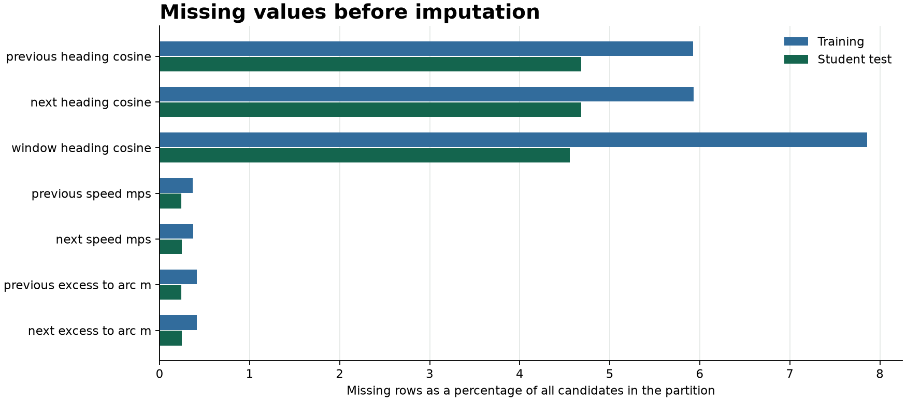
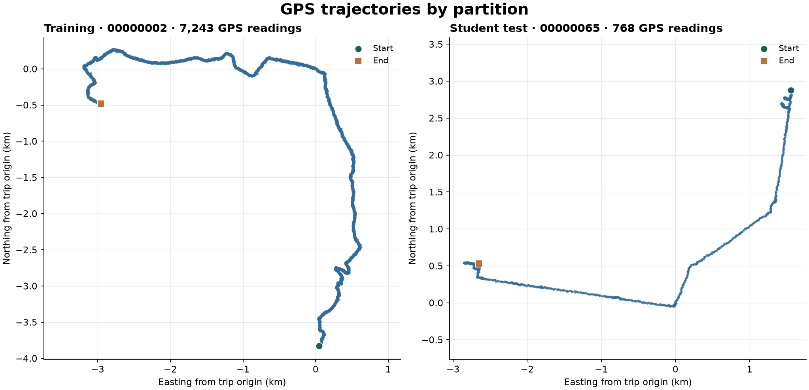
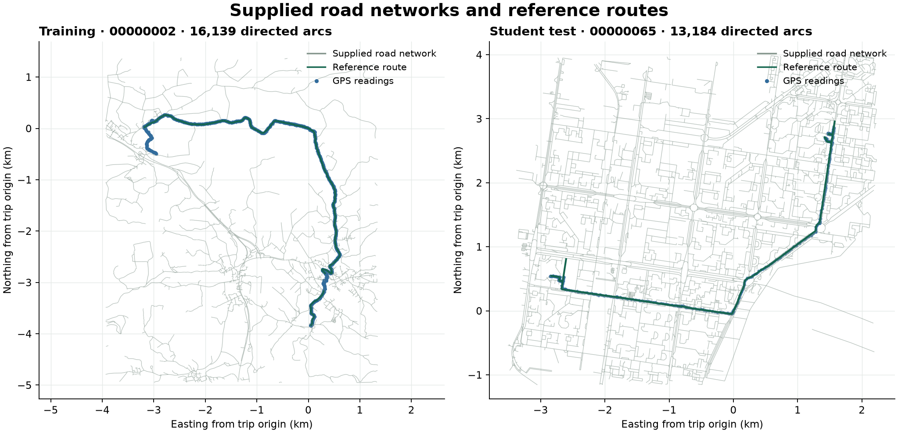
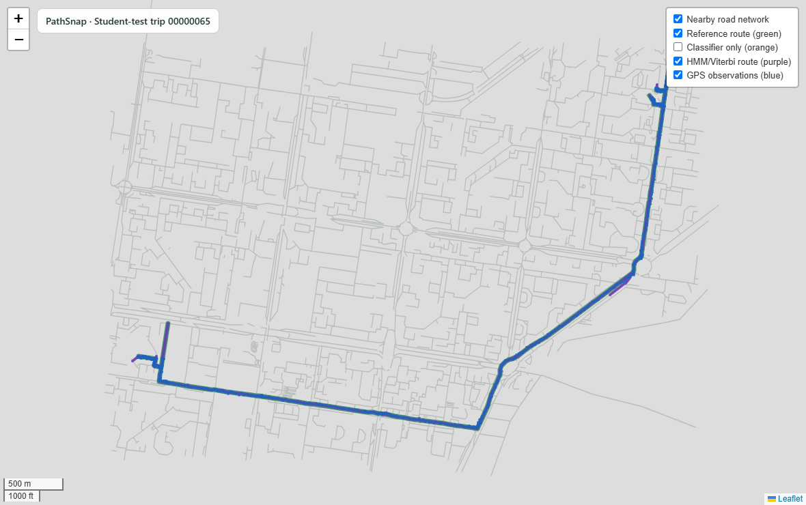

# PathSnap data exploration and preprocessing

## How did we preprocess the data?

We read four files for each trip. The GPS track provides longitude, latitude, and timestamps. The node and arc files define the road network as directed edges. The reference route lists the arcs traversed in order. We checked coordinate ranges, timestamp order, and node and arc indices. All 90 training and student-test trips parsed successfully, with zero nonfinite numeric values in their parsed raw fields.

We projected the GPS and road coordinates into local metres. For each reading, we found up to eight directed road candidates within 50 m, then projected the GPS point onto each arc to get its distance and fractional position. We aligned the GPS observations to the ordered reference route. An observation whose assigned reference arc was more than 50 m away remained unlabeled. Candidate rows from aligned observations supplied the binary match labels for supervised fitting. In Top-1 evaluation, a labeled observation still counted as an error if its reference arc was absent from the candidate set.

Feature values could be missing even when the raw files were complete. For example, GPS motion under 3 m did not provide a reliable heading, and a time gap over 10 s prevented a neighboring reading from providing short-term motion evidence. The model pipelines filled missing feature values with medians learned inside each training fold. Logistic regression and Gaussian Naive Bayes also standardized their inputs inside each fold. Trip IDs grouped complete drives in cross-validation. Arc IDs identified predictions. Reference routes supplied labels for training and scoring.

## What patterns did we observe?

| Measurement | Training | Student test |
| --- | ---: | ---: |
| Trips | 80 | 10 |
| GPS observations | 208,417 | 19,160 |
| Aligned GPS observations | 185,227 (88.87%) | 19,133 (99.86%) |
| Unlabeled GPS observations | 23,190 | 27 |
| GPS observations without any candidate within 50 m | 18,230 | 0 |
| All candidate rows | 1,084,804 | 113,649 |
| Labeled candidate rows | 1,059,686 | 113,589 |
| GPS intervals of one second | 96.50% | 98.62% |
| GPS gaps longer than 10 seconds | 590 | 27 |
| Directed road arcs | 3,876,904 | 185,041 |
| Zero-length road arcs | 100 | 6 |
| Nearest-road observation Top-1 | 55.96% | 53.72% |

- GPS sampling was usually one reading per second, with a mix of short interruptions and long gaps. The largest training gap was 153,064 s on trip `00000090`. The student-test maximum was 210 s on trip `00000065`. In the trajectory figure, lines stop at gaps over 10 s.
- Candidate search covered the aligned reference road for 99.27% of training observations and 99.72% of student-test observations. Choosing the nearest candidate alone achieved only 55.96% and 53.72% Top-1 respectively. The road-network plots show how nearby or parallel arcs can both be plausible by distance.
- Heading was the most commonly missing engineered signal. The table below reports missing values before imputation over all candidate rows. [Full missing-value CSV](missing_values.csv)

| Feature | Training missing | Student-test missing |
| --- | ---: | ---: |
| Previous heading cosine | 64,298 (5.93%) | 5,320 (4.68%) |
| Next heading cosine | 64,340 (5.93%) | 5,325 (4.69%) |
| Window heading cosine | 85,239 (7.86%) | 5,177 (4.56%) |
| Previous speed | 4,010 (0.37%) | 271 (0.24%) |
| Next speed | 4,022 (0.37%) | 282 (0.25%) |
| Previous-reading excess distance | 4,457 (0.41%) | 271 (0.24%) |
| Next-reading excess distance | 4,490 (0.41%) | 282 (0.25%) |

## Which features did we extract and why?

The original tuned classifier used 20 numeric features. Distance and position describe the current GPS point. Motion, nearby readings, and road connections provide context when nearby candidates are hard to distinguish.

| Feature group | Inputs | Reason |
| --- | --- | --- |
| Proximity and candidate competition | `distance_m`, `candidate_rank`, `distance_above_nearest_m`, `candidate_count` | Compare the candidate against nearby alternatives and recognize crowded candidate sets. |
| Position along the road | `arc_fraction`, `arc_length_m`, `distance_to_start_m`, `distance_to_end_m` | Identify projected positions near segment endpoints and junctions. |
| Motion and direction | `previous_heading_cosine`, `next_heading_cosine`, `window_heading_cosine`, `previous_speed_mps`, `next_speed_mps`, and the three heading-availability flags | Measure travel direction and speed. The wider window reduces reliance on a single GPS step. Availability flags preserve whether heading was observed. |
| Fit at nearby observations | `previous_excess_to_arc_m`, `next_excess_to_arc_m` | Compare how well the current candidate fits neighboring GPS readings against the nearest road at each of those readings. |
| Directed connectivity | `incoming_degree`, `outgoing_degree` | Describe the alternatives entering and leaving the candidate arc at its endpoints. |

## Figures and partitions

**Missing-value analysis.** All 80 training trips and 10 student-test trips. The plot shows features with at least one missing value in either partition.



**GPS trajectories.** Training trip `00000002` and student-test trip `00000065`. The figures use local metre coordinates converted to kilometres.



**Road networks.** The same training and student-test trips. Gray lines show the supplied road geometry, green shows the reference route, and blue shows GPS readings. Reverse-direction pairs share a plotted line.



**Folium geographical map.** Student-test trip `00000065`. The map overlays GPS observations and the reconstructed HMM/Viterbi route on the supplied local road network, with the development reference route available for comparison. Use the command below to generate the interactive HTML map locally.



The reserved evaluator trips were used for final model and decoder testing. The exploration figures and missing-value statistics above use the training and student-test partitions.


## Regenerate the figures

Install the Python dependencies with `python -m pip install -r requirements.txt -r requirements-person2.txt`. From the repository root, run the following commands with the organizer's training and student-test files available locally.

```powershell
python -m reports.eda.prepare_eda "Student folder" "outputs/eda"
python -m pathsnap.hmm_experiments --data-root "Student folder" --output "outputs/hmm-map" --map-trip 00000065
```

Open `outputs/hmm-map/student_test_00000065.html` in a browser. The [decoder documentation](../../HMM.md) describes the comparison and the Folium layers.
